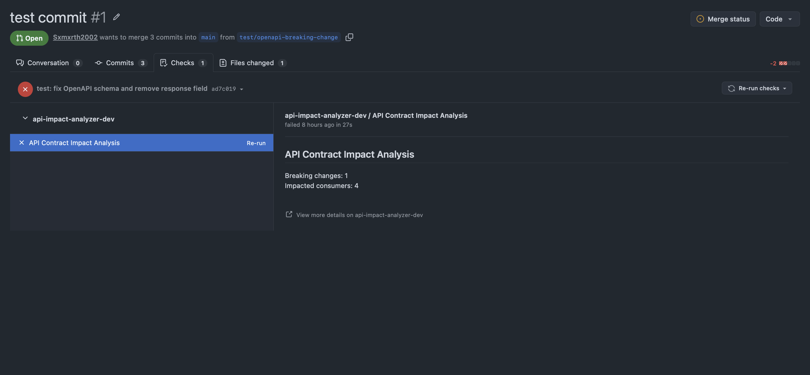

# API Impact Analyzer

A TypeScript-based tool that detects breaking OpenAPI contract changes, identifies affected consumer code, and automatically reports potential issues on GitHub pull requests.

## Features

### 1. OpenAPI Contract Analysis
- Compares old and new OpenAPI specifications.
- Detects removed endpoints and response fields.
- Identifies incompatible response field types.
- Detects newly required request fields and removed response status codes.
- Generates human-readable and JSON reports.

### 2. Consumer Impact Analysis
Uses TypeScript Abstract Syntax Tree (AST) analysis through `ts-morph` to identify potentially affected consumers.

- Detects API calls using `fetch` and Axios.
- Tracks response field access and destructuring.
- Identifies missing required request body fields.
- Matches dynamic endpoint paths such as `/users/{id}`.
- Validates API hostnames against OpenAPI server definitions.
- Reports impacted files and line numbers.

### 3. GitHub Pull Request Integration
- Integrates with GitHub using a GitHub App.
- Receives pull request webhook events.
- Processes analysis jobs asynchronously using BullMQ and Redis.
- Compares API specifications across pull request revisions.
- Publishes analysis results through GitHub Checks.

## Architecture

```text
GitHub Pull Request
        |
        v
GitHub App Webhook
        |
        v
Fastify Webhook Server
        |
        v
BullMQ + Redis Queue
        |
        v
Background Worker
        |
        v
OpenAPI Diff Engine
        |
        v
TypeScript Consumer Analyzer
        |
        v
Impact Report
        |
        v
GitHub Checks API
```

## Tech Stack

- **Language:** TypeScript
- **Backend:** Fastify
- **Static Analysis:** ts-morph
- **Background Jobs:** BullMQ, Redis
- **GitHub Integration:** GitHub Apps, Octokit
- **API Specifications:** OpenAPI 3.0

## CLI Usage

Install dependencies:

```bash
npm install
```

Run contract analysis:

```bash
npm run dev -- --before examples/old-api.yaml --after examples/new-api.yaml
```

Generate JSON output:

```bash
npm run dev -- --before examples/old-api.yaml --after examples/new-api.yaml --format json
```

### Exit Codes

| Code | Meaning |
|---|---|
| 0 | No breaking changes |
| 1 | Analysis error |
| 2 | Breaking changes detected |

## Current Limitations

**OpenAPI analysis**
- Nested response properties are not recursively compared.
- Comprehensive schema composition analysis is not supported.
- OpenAPI 3.1 is not yet supported.
- Circular references are not fully resolved.

**Consumer analysis**
- Only TypeScript and TSX consumers are supported.
- API URLs must be statically identifiable and absolute for host matching.
- Host matching uses the first OpenAPI server URL.
- Dynamic property access may not be detected.
- Incompletely analyzable request payloads are skipped.
- Some direct response access patterns are unsupported.
- Cross-file data flow and complex runtime behavior are not analyzed.

The analyzer uses conservative static analysis and does not guarantee detection of every affected consumer.

## Roadmap

- [x] Phase 1: OpenAPI Contract Diff Engine
- [x] Phase 2: TypeScript Consumer Dependency Analysis
- [x] Phase 3: GitHub App Integration and Asynchronous PR Analysis
- [ ] Phase 4: AI-Generated Impact Explanations using Ollama
- [ ] Phase 5: React Dashboard

## Project Status

Phases 1–3 are implemented. AI-generated explanations and the React dashboard are planned for future development.

